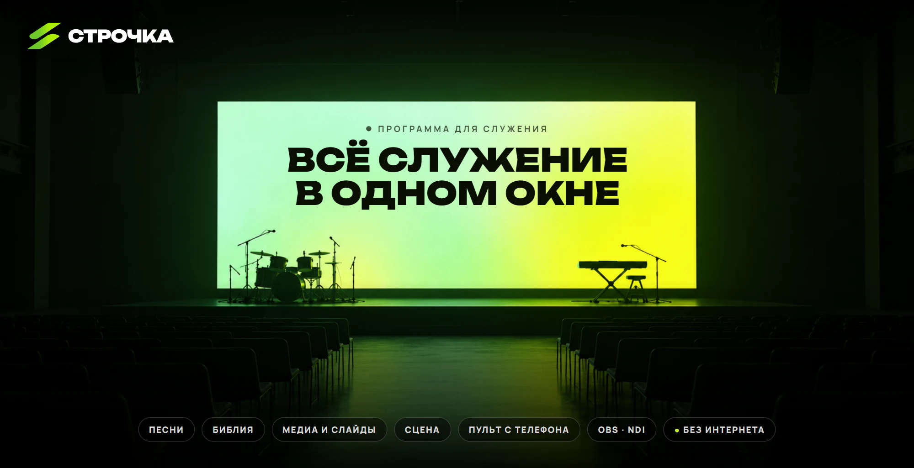
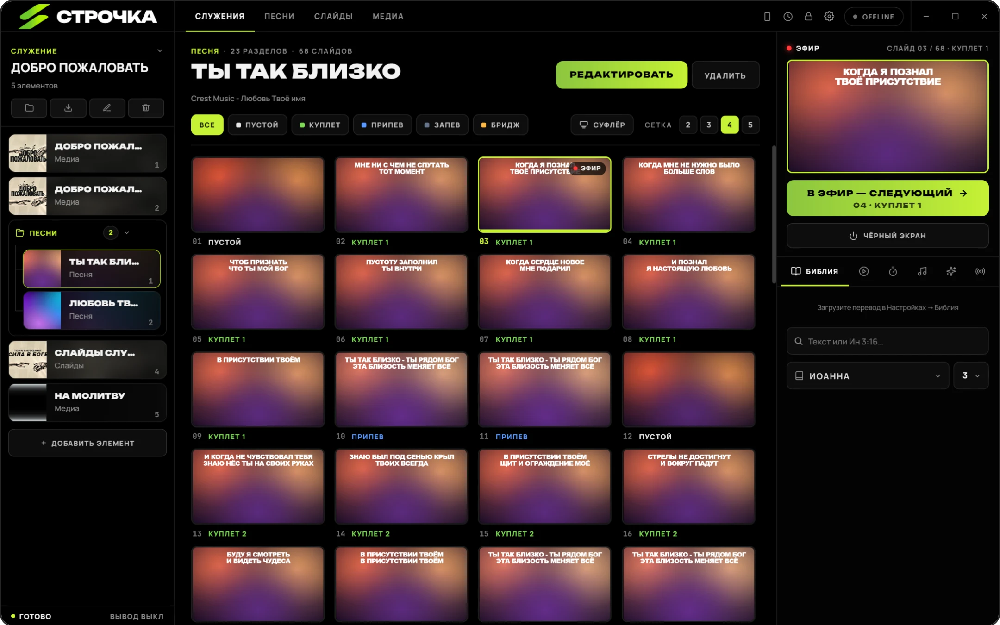
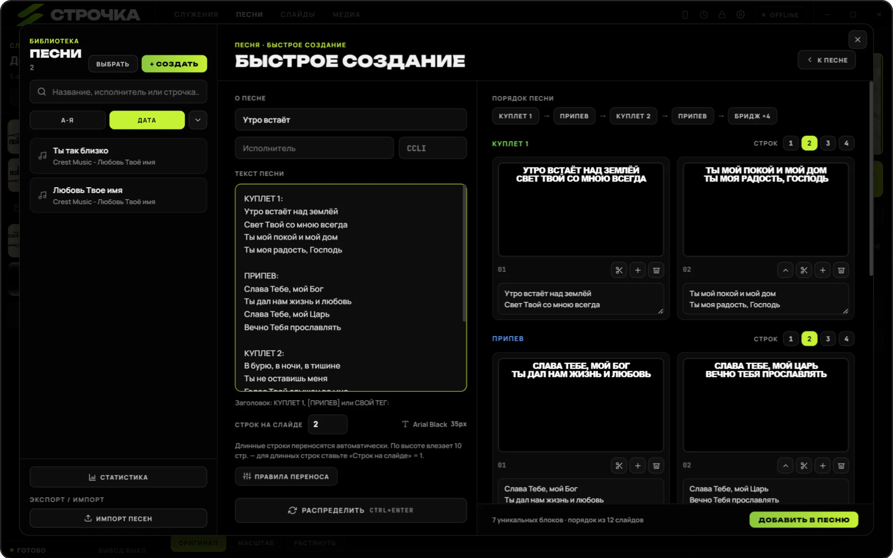
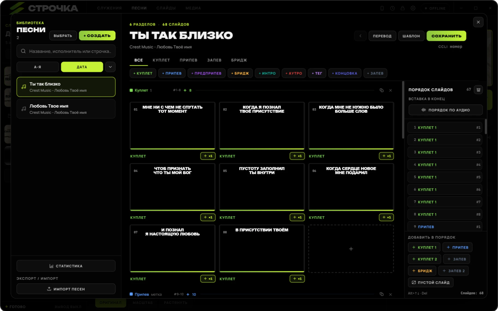
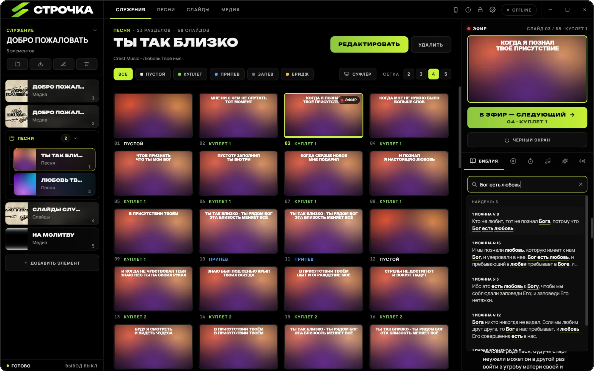
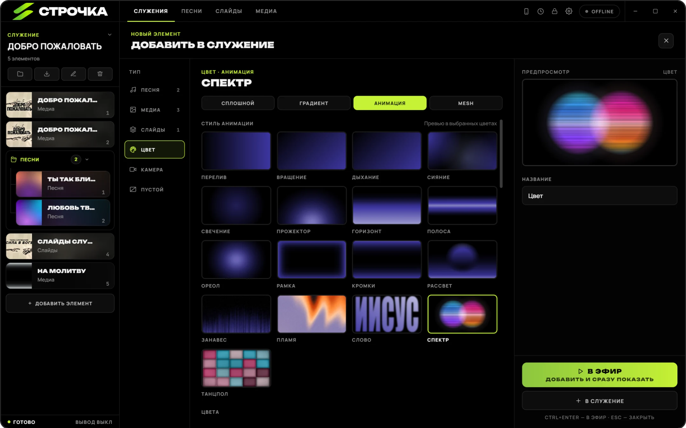
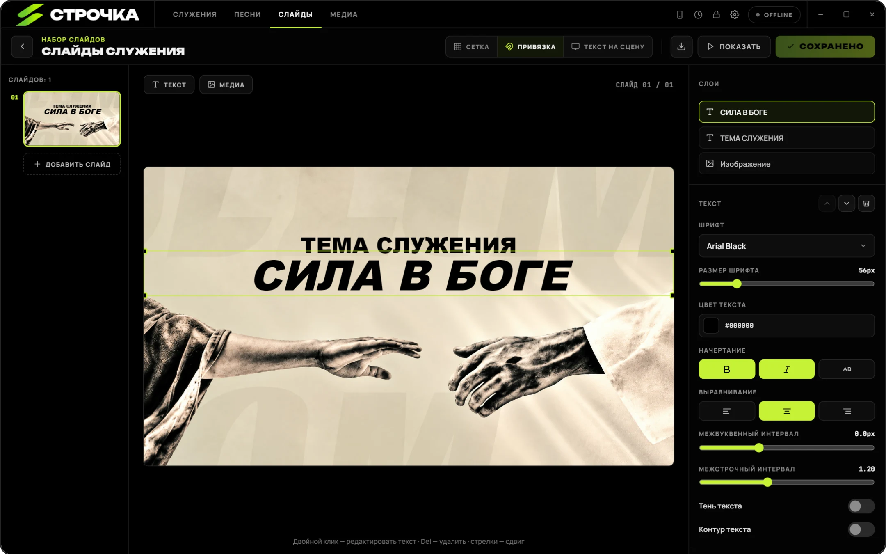
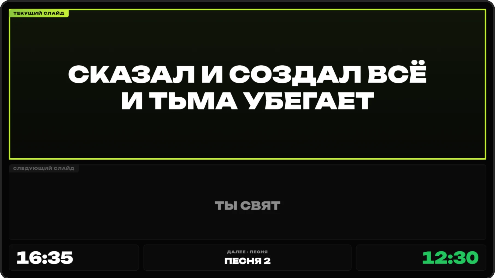
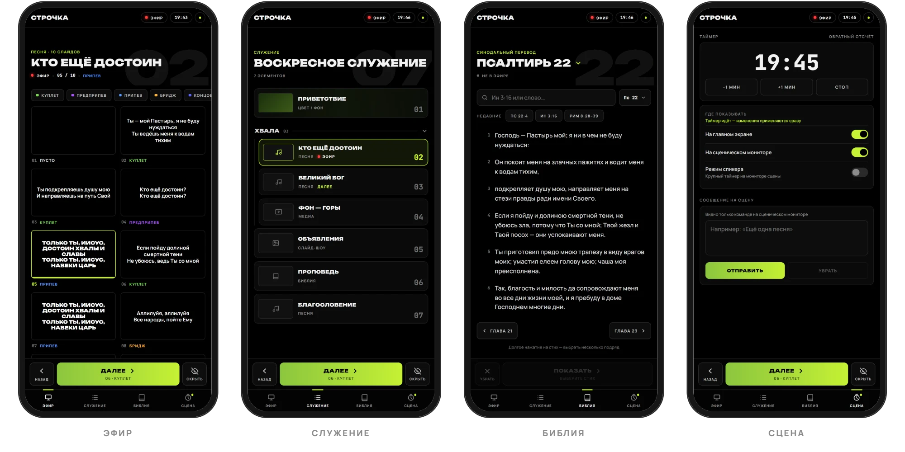

  

  <b>Слова песен, Библия, фото, видео и слайды — на проектор, сценический монитор и в трансляцию.</b> 
  Работает локально: служение не зависит от интернета.

  
  
  
  

  <a href="https://github.com/mynamevladd/Strochka/releases/latest"><b>⬇ Скачать</b></a> &nbsp;·&nbsp;
  <a href="https://strochka-app.ru">Сайт</a> &nbsp;·&nbsp;
  <a href="#возможности">Возможности</a> &nbsp;·&nbsp;
  <a href="#установка">Установка</a> &nbsp;·&nbsp;
  <a href="https://t.me/mynameisvladdd">Написать автору</a>

 

  

> **Открытый бета-тест.** Строчка бесплатна навсегда — на любом числе компьютеров, в церкви и не только.
> Платная только подписка PRO: пульт с телефона, сценический монитор и синхронизация песен.

---

## Возможности

### 🎵 Песня на экране за минуту

Вставьте текст целиком — Строчка сама разложит его по слайдам, найдёт куплеты, припевы и бридж и соберёт порядок.
Строки переносятся по реальному шрифту, а не «на глазок». Порядок слайдов можно собрать даже **по записи песни**:
программа распознает её прямо на компьютере, без интернета.

  

<table>
<tr>
<td width="50%" valign="top">

**Библиотека песен**
- поиск по названию, исполнителю и строчке
- импорт из ProPresenter, экспорт и обмен файлами
- перевод песни под основным текстом — вставьте перевод, Строчка сама разложит его по слайдам
- «суфлёр»: следующая строка мелко под текущей

</td>
<td width="50%" valign="top">

**Статистика**
- что пели, когда и как часто
- «давно не пели» — чтобы песни не терялись
- отчёт CCLI в CSV одной кнопкой

</td>
</tr>
</table>

  

### 📖 Библия — по адресу или по словам

Пишите как удобно: «Ин 3:16», «ин3 16», «Откр 21» — или просто слова из стиха.
Поиск понимает окончания («любовь» найдёт «любви»), опечатки и даже текст в неправильной раскладке.
Стих выходит поверх слайда с отдельным переходом, а внутри главы листается мгновенно.

  

### 🌈 Живые фоны

Цвет, градиент, mesh и анимированные стили: перелив, прожектор, занавес, пламя, огромное слово «Иисус» в расфокусе,
спектр, светодиодный танцпол. Фон может «дышать» вместе с песней — на припеве ярче, на куплете спокойнее.
Плюс свои картинки и видео.

  

### 🖼 Слайды и медиа

Свободный редактор слайдов: текст, картинки, фон, слои, привязка к сетке. Набор слайдов становится одним элементом служения.
Фото, видео и камера — тоже элементы служения и переключаются без остановки эфира.
Набор слайдов можно экспортировать в файл и передать в другую церковь.

  

### 🎤 Сценический монитор PRO

Отдельный экран для служителей: текущий и следующий слайд, часы, следующий элемент, таймер и сообщения от оператора.
Открывается окном на втором мониторе или в браузере любого телевизора и планшета в той же сети.

  

### 📱 Пульт с телефона PRO

Сканируете QR-код — и телефон становится пультом: листать слайды, выбирать элемент служения, выводить стихи,
управлять таймером и писать на сцену. Без приложения и без регистрации, по локальной сети.

  

### И ещё

<table>
<tr>
<td width="33%" valign="top">

**📺 Несколько экранов**
Проектор, второй экран, NDI-выход. На каждом — свои слои: камера, фон, слова, Библия внизу.

</td>
<td width="33%" valign="top">

**🎬 OBS**
Сцены переключаются сами под элемент служения. Микшер, запуск трансляции и записи прямо из Строчки.

</td>
<td width="33%" valign="top">

**⏱ Таймер и объявления**
Обратный отсчёт и секундомер — на сцене, в зале или там и там. Текстовые объявления поверх эфира.

</td>
</tr>
<tr>
<td valign="top">

**✨ Переходы**
Отдельно между слайдами, между элементами и для появления Библии.

</td>
<td valign="top">

**🎹 MIDI и горячие клавиши**
Листайте с клавиатуры, пульта-кликера или MIDI-контроллера.

</td>
<td valign="top">

**🛟 Надёжность**
Окна восстанавливаются сами, служения сохраняются на диск с ежедневными копиями.

</td>
</tr>
</table>

---

## Установка

| | Что скачать | Подсказка |
|---|---|---|
| **Windows 10 / 11** | `Strochka-Setup-<версия>.exe` | Запустите и следуйте мастеру установки. |
| **macOS 11+ · Apple Silicon** | `Strochka-<версия>-arm64.dmg` | Сборка пока без подписи Apple: при первом запуске откройте «Системные настройки» → «Конфиденциальность и безопасность» → «Всё равно открыть». |
| **macOS 11+ · Intel** | `Strochka-<версия>-x64.dmg` | То же, что и для Apple Silicon. |

Все файлы — на странице [последнего релиза](https://github.com/mynamevladd/Strochka/releases/latest).
На Windows программа обновляется сама. При первом запуске откроется демо-служение и короткое обучение.

## Обратная связь

Нашли ошибку или не хватает функции — [создайте issue](https://github.com/mynamevladd/Strochka/issues) или напишите в [Telegram](https://t.me/mynameisvladdd).
Что изменилось в каждой версии — в [релизах](https://github.com/mynamevladd/Strochka/releases) и в самой программе: **Настройки → Основные → Что нового**.

---

<b>English</b>

 

**Strochka** is presentation software for church services: song lyrics, Bible verses, photos, video and slides —
on the projector, the stage monitor and the livestream. It runs fully offline.

- **Songs** — paste the lyrics, get slides with verse/chorus structure and order; build the order from a recording (on-device speech recognition); translations under the main text; CCLI report.
- **Bible** — search by reference or by words, tolerant to typos and word forms.
- **Backgrounds** — colour, gradient, mesh and animated styles, backgrounds that follow the song's sections.
- **Slides & media** — free-form slide editor, photos, video, live camera.
- **Stage monitor** and **phone remote** (PRO), several outputs, NDI, OBS control, timers and announcements.

The app is free forever; only the PRO subscription (phone remote, stage monitor, song sync) is paid.
Interface in Russian and English. Download from the [latest release](https://github.com/mynamevladd/Strochka/releases/latest).

   
  <a href="https://strochka-app.ru"><b>strochka-app.ru</b></a>

